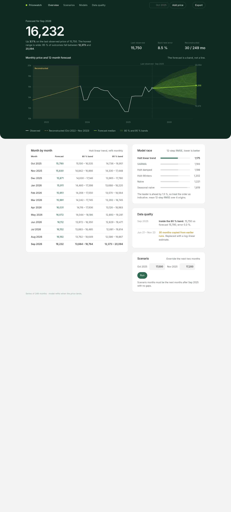

# price-forecast-platform

End-to-end monthly price forecasting: a Django + DRF service that serves the
Holt-linear forecast from the case study (`notebooks/`), and a Next.js 16
dashboard that renders the approved design (`design/dashboard-band.html`) with
every number taken from the API.



## Run it

```bash
cp Backend/.env.example Backend/.env        # optional, sane defaults exist
docker compose up --build
```

- Dashboard: http://localhost:3000
- API: http://localhost:8000 (`/api/v1/…`, plus `/api/docs/` and `/api/schema/`)

The backend container migrates and seeds its first forecast on boot when its
empty `data/` volume is mounted; later boots keep whatever observations landed.

### Architecture

```
┌──────────────────────────── docker compose ────────────────────────────┐
│                                                                       │
│  ┌──────────────────┐  SSR fetch (API_BASE_INTERNAL)  ┌────────────┐  │
│  │ frontend         │ ───────────────────────────────►│ backend    │  │
│  │ Next.js 16.4.4   │     http://backend:8000          │ Django 5 + │  │
│  │ :3000            │   browser fetch (CORS origin     │ DRF :8000  │  │
│  └──────────────────┘     NEXT_PUBLIC_API_BASE)  ────►│ gunicorn   │  │
│          ▲                                            │ SQLite │   │
│          │ http://localhost:3000                      │ data/(volume)│ │
└──────────┴────────────────────────────────────────────┴────────────┘
```

- Server Components`back the hero strip, chart, table, model race and data
  quality from the read endpoints with 5-minute revalidation.
- The browser calls the API directly for the interactive pieces
  (`POST /predict/`, `POST /observations/`), allowed by
  `CORS_ALLOWED_ORIGINS` / `FRONTEND_ORIGIN`.

## Modelling

The series is cleaned exactly as in
[`notebooks/Monthly_Price_Forecasting_corrected.ipynb`](notebooks/Monthly_Price_Forecasting_corrected.ipynb)
(30 copied months replaced by log-linear interpolation; see the full write-up in
[`docs/Monthly Price Forecasting – Case Study Report.pdf`](docs/Monthly%20Price%20Forecasting%20–%20Case%20Study%20Report.pdf)).

Among the candidate models compared on a rolling-origin back-test ("mean 12-step
RMSE over 4 origins"), **Holt linear trend wins with 1,175 — 1.5 % ahead of
SARIMA (1,193)**, so it was promoted as the champion and refits every time a new
observation lands. The order is indicative: the gap is out of step with the
intervals' width.

Known limitations: 30 of the 249 months are reconstructed from copied history,
not observed; and everything is learned from a single series.

## Development

- Backend: see `Backend/README.md` (`migrate`, `seed`, `test`, `runserver`).
- Frontend: `cd frontend && npm install && npm run dev` — generate the typed
  client with `npm run types:api` against a running backend.
