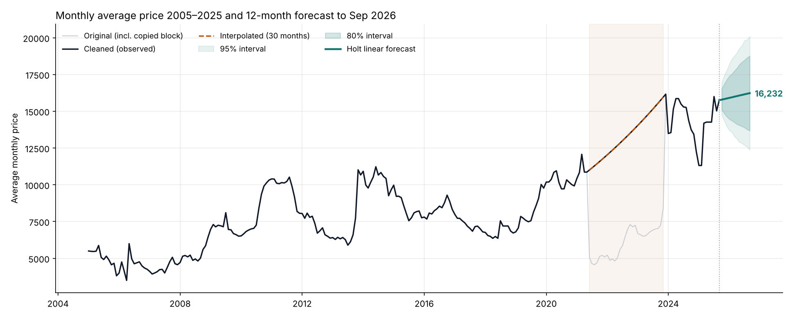
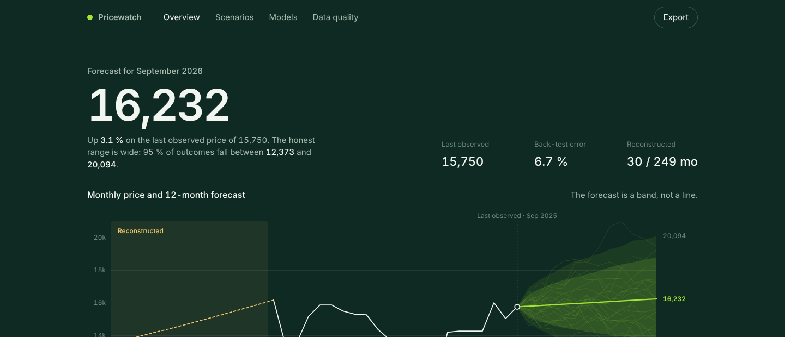
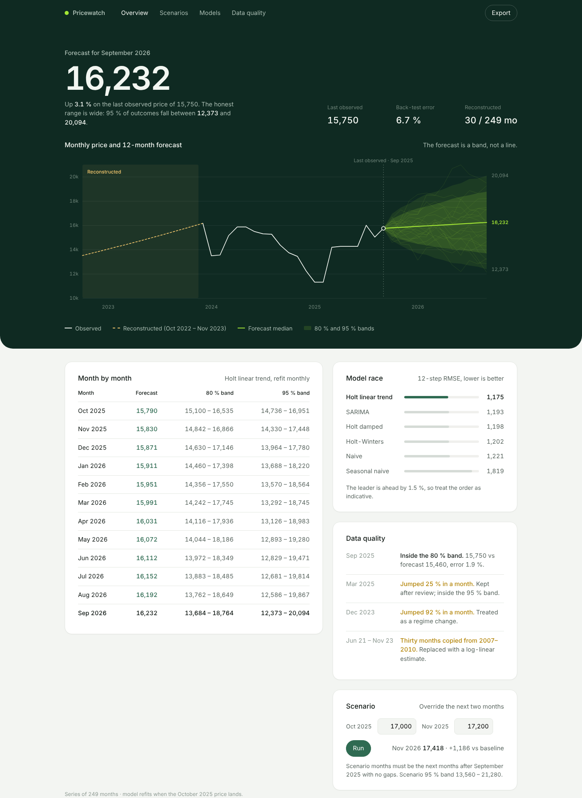
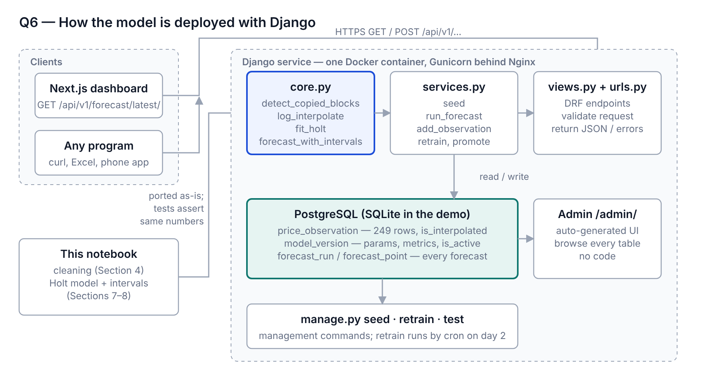
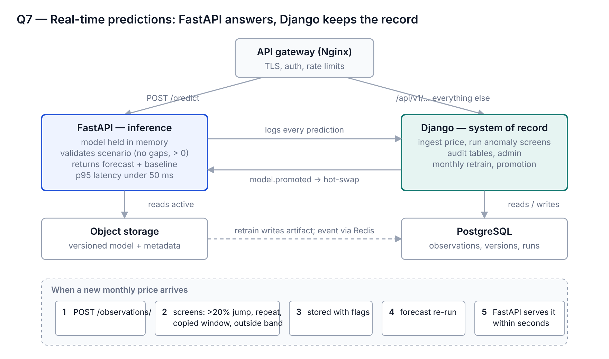
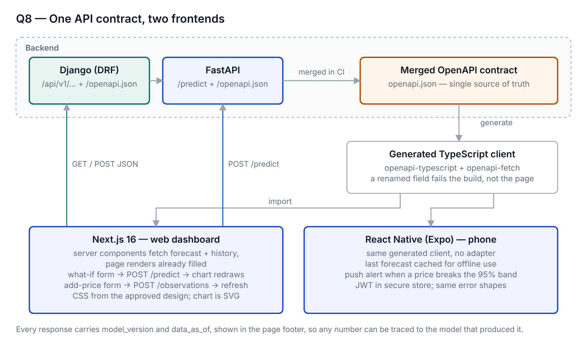
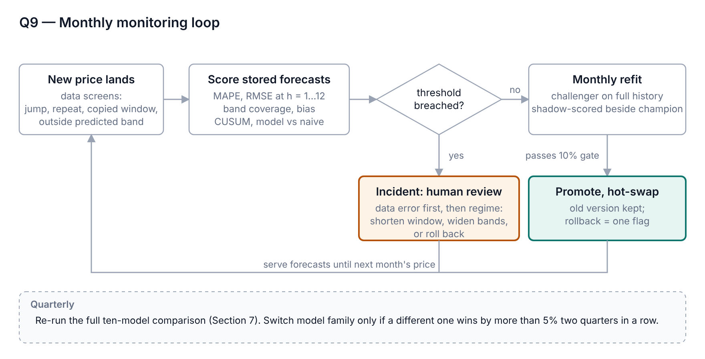

# Monthly Price Forecasting — end-to-end

**A 12-month price forecast, from a notebook with a hidden data problem to a deployed Django service with a live dashboard.**

> **Live demo**
> - Dashboard: https://frontend-psi-seven-51.vercel.app
> - API: https://price-forecast-api-m0pp.onrender.com (free plan — first request after ~15 min idle may take ~50 s to wake; retry once)
> - API docs: https://price-forecast-api-m0pp.onrender.com/api/docs/



| | |
|---|---|
| **Data** | 249 monthly average prices, Jan 2005 – Sep 2025 |
| **Finding** | 30 months (Jun 2021 – Nov 2023) were an exact copy of 2007–2010 data; detected automatically and replaced with a log-scale interpolation |
| **Model** | Holt's linear trend, selected from 10 candidates on a horizon-matched rolling-origin test |
| **Accuracy** | 12-month-ahead MAPE **6.7 %**, RMSE **1,175** (mean over 4 origins); 1.5 % ahead of SARIMA, 4 % ahead of naive |
| **Forecast** | 15,790 (Oct 2025) → **16,232** (Sep 2026), +3.1 %; 95 % interval at 12 months 12,373 – 20,094 |
| **Production** | Django + DRF service, tests, Docker, champion-challenger retrain; dashboard frontend |

---

## Contents

```
.
├── notebooks/
│   ├── Monthly_Price_Forecasting_corrected.ipynb   # full analysis + answers to all 9 case questions
│   └── price_data.csv
├── Backend/                                        # Django 5 + DRF service (see Backend/README.md)
│   ├── forecast/core.py                            # cleaning + model, ported unchanged from the notebook
│   ├── forecast/{models,services,views,urls}.py
│   ├── forecast/tests.py                           # 5 tests incl. golden-forecast check
│   ├── Dockerfile · requirements.txt
│   └── data/price_data.csv
├── frontend/                                       # Next.js 16 dashboard (reads the backend API)
├── Design/
│   └── dashboard-band.html                         # approved UI design, static reference
├── docs/
│   ├── Monthly Price Forecasting – Case Study Report.pdf   # the 9 answers with diagrams
│   ├── images/
│   └── screenshots/
└── AGENT_TASKS.md                                  # build spec for the frontend + compose wiring
```

---

## Run it

**Backend only (2 minutes)**

```bash
cd Backend
python -m venv .venv && source .venv/bin/activate      # Windows: .venv\Scripts\activate
pip install -r requirements.txt
python manage.py migrate
python manage.py seed        # load CSV → detect copied block → interpolate → fit model → first forecast
python manage.py test        # 5 tests, all green
python manage.py runserver   # http://127.0.0.1:8000  (dashboard)   /api/v1/forecast/latest/  (JSON)
```

**Backend + frontend together**

```bash
docker compose up --build    # http://localhost:3000 dashboard · http://localhost:8000 API · /admin/
```

---

## The dashboard



Every number on the page comes from the API: hero figure and intervals from `/forecast/latest/`, the chart from `/history/` + `/forecast/latest/`, the model race from `/models/compare/`, the data-quality notes from `/observations/`. The what-if panel posts to `/predict/` and redraws with scenario and baseline side by side.

<details>
<summary>Full-page screenshot</summary>


</details>

---

## What the notebook does

1. **Validate** — no missing months, duplicates or gaps in 249 rows.
2. **Find the anomaly** — a sliding 6-month window shows Jun 2021 – Dec 2022 is a value-for-value copy of Oct 2007 – Apr 2009, and Jan – Nov 2023 copies Oct 2009 – Aug 2010.
3. **Clean** — treat the 30 months as missing, interpolate on the log scale between the real values either side (May 2021 = 10,863, Dec 2023 = 16,163), keep the originals in a separate column, flag every estimated row.
4. **Outliers** — rolling-median / MAD robust z-score flags five months; all investigated and kept as genuine market moves.
5. **Model** — 10 candidates (3 baselines, ARIMA, SARIMA, 4 exponential-smoothing variants, log-ARIMA), all trained on Jan 2005 – Sep 2024 only.
6. **Evaluate three ways** — single 12-month holdout, 1-step walk-forward, and a **12-step rolling-origin test from four origins** (the one that matches the task).
7. **Sensitivity** — re-run the comparison with the copied block kept raw and with it excluded; seasonal models collapse, trend models hold.
8. **Forecast** — Holt linear on all 249 months, 80 % and 95 % intervals from 2,000 simulated paths.

| Model | Mean 12-step RMSE | Mean MAPE |
|---|---|---|
| **Holt linear trend** (selected) | **1,175** | **6.7 %** |
| SARIMA (0,1,0)(0,1,1)₁₂ | 1,193 | 6.9 % |
| Holt damped trend | 1,198 | 6.9 % |
| Holt-Winters additive | 1,202 | 6.8 % |
| Naive / ARIMA(0,1,0) | 1,221 | 7.0 % |
| Seasonal naive | 1,819 | 11.6 % |

The margin over the runner-up is small and the notebook says so; the selection is presented as the best-supported choice, not a decisive one.

---

## Architecture

### Model deployed in Django


The notebook's cleaning and modelling functions are ported unchanged into `core.py`; a test asserts the service reproduces the notebook's forecast. Django adds the database (observations, model versions, every forecast run), DRF endpoints, an auto-generated admin, and a `retrain` command that promotes a new version only if its back-test RMSE is within 10 % of the champion's.

### Real-time predictions: Django + FastAPI


Django is the system of record (ingestion, anomaly screens, audit, retrain). FastAPI serves `/predict` from a model held in memory, validates scenarios, and returns scenario + baseline in under 50 ms. In this repository Django alone handles both roles (`/api/v1/predict/` answers in ~20 ms); the split is the next step if load requires it.

### One API contract, two frontends


Both services publish OpenAPI; CI merges the schemas and generates a typed TypeScript client used by Next.js (web) and React Native (phone). A renamed field fails the build, not the page.

### Monitoring loop


Every month: screen the new price, score every stored forecast (MAPE, coverage, bias, CUSUM, model vs naive), refit a challenger, promote only through the 10 % gate; any threshold breach opens a human review. Quarterly, re-run the full ten-model comparison.

---

## API

| Method | Path | Purpose |
|---|---|---|
| GET | `/api/v1/health/` · `/ready/` | liveness / readiness |
| GET | `/api/v1/history/` | 249 months with `is_interpolated` flags |
| GET | `/api/v1/forecast/latest/` | latest 12-month forecast with 80/95 % intervals |
| GET | `/api/v1/forecast/runs/` | audit log of every run |
| POST | `/api/v1/predict/` | real-time forecast; optional `scenario` months; returns baseline too |
| GET / POST | `/api/v1/observations/` | flagged months / append next month's price → screens → re-forecast |
| GET | `/api/v1/models/versions/` | model registry with metrics and promotion reason |
| POST | `/api/v1/models/retrain/` | champion-challenger retrain |

Example:

```bash
curl -X POST localhost:8000/api/v1/predict/ -H 'Content-Type: application/json' \
  -d '{"horizon":12,"scenario":[{"month":"2025-10-01","price":17000},{"month":"2025-11-01","price":17200}]}'
```

---

## Known limitations

- 30 of 249 training months are estimates, not observations; Section 7.9 of the notebook quantifies the effect.
- Single series, no external drivers (demand, supply, FX). The model is a statistical baseline, not a causal one.
- The winning margin is 1.5 %; a quarterly re-selection is part of the monitoring plan for that reason.
- A production toggle file isn't wired yet: for production use Gunicorn + Nginx, PostgreSQL, `DEBUG=0`, CORS pinned, cron for retrain — all described in `Backend/README.md`.

## Stack

Python 3.11 · pandas · statsmodels 0.15 · Django 5 · Django REST Framework · SQLite/PostgreSQL · Docker · Next.js 16 · TypeScript

## Author

sameendhanimisetti — [sameendhanimisetti@gmail.com](mailto:sameendhanimisetti@gmail.com) · [github.com/sam1dh](https://github.com/sam1dh)
